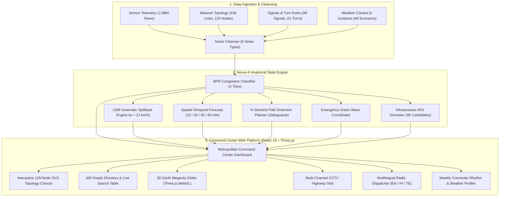

<h1 align="center">🚦 MargaNetra: Neura-X Integrated Traffic Intelligence System</h1>
<p align="center">
  <b>Neurax Hackathon 3.0 — Domain 1: AI in Smart Cities</b><br>
  <i>A Production-Grade Decision-Support Brain & Command Center for Dense Urban Networks</i>
</p>

<p align="center">
  
  
  
  
  
  
  
  
  
  
  
</p>

---

## 📌 Problem Understanding & Motivation

### The Urban Challenge
Managing large, rapidly shifting urban road networks is an immense challenge. Traffic conditions change within minutes: a single stalled auto-rickshaw or breakdown on a narrow Hyderabad flyover ramp can trigger an unmanaged spillback cascade that paralyzes an entire corridor within 15 minutes. Traditional human operators in municipal traffic command centers react too late and lack tools to anticipate bottlenecks before they escalate.

### What MargaNetra (Neura-X) Is
**Not** an individual navigation app. **Not** a basic chatbot. MargaNetra is an **AI-powered traffic command center brain** that provides real-time situational intelligence to human operators, city planners, and emergency services:

| Capability | Operational Function |
| :--- | :--- |
| 🔍 **Real-Time Network State** | Telemetry and congestion classification across all 436 directed highway corridors. |
| 🔮 **Multi-Horizon Forecasting** | Forward projection of speeds, flows, and bottlenecks at $+15$, $+30$, $+45$, and $+60$ minutes. |
| 🌊 **Causal Spillback Tracing** | Lighthill-Whitham-Richards (LWR) kinematic wave tracking: identifies *why* a road is congested and calculates exact upstream intersection choke times. |
| 🔀 **Diversion Planning (K-Shortest Paths)** | 3-tier alternate bypass generation with neighborhood capacity safeguards. |
| 🚑 **Emergency Green Wave Corridor** | Preemptive signal cycle phase synchronization across up to 8 consecutive junctions. |
| 🏗️ **Infrastructure Planner (BPR Optimization)** | Counterfactual delay simulations across 90 civil engineering candidates with Cost-Benefit scores. |
| 🎙️ **Multilingual Radio Dispatch** | Instant audio alerts and voice broadcasts in **English**, **Hindi (हिंदी)**, and **Telugu (తెలుగు)**. |

### Operating Environment (Hyderabad Urban Context)
* **Dense Mixed Traffic**: Autos, 2-wheelers, buses, freight trucks, and cars sharing multi-lane arterials.
* **Peak-Hour Directional Surges**: Massive commuter inflows ($07:30 - 10:30$) and evening outflows ($17:00 - 21:00$).
* **Signalized Junction Matrix**: 89 coordinated traffic controllers with cycle times between 90s and 120s.
* **Flyovers & Grade Separations**: Complex multi-level merge and diverge points.
* **Weather Vulnerabilities**: Heavy monsoon downpours (+45% travel delay penalty) causing urban waterlogging.

---

## 📊 Dataset & Topological Specifications

The system models a metropolitan network spanning coordinates `17.30°N` to `17.46°N` and `78.35°E` to `78.55°E`:

### 1. Network Topology
| Component | Count | Description |
| :--- | :---: | :--- |
| **Road Corridors** | **436** | Directed graph edges (`R0001`–`R0436`) with lane counts, capacities ($V_{\text{max}}$), speed limits, and grades. |
| **Junction Nodes** | **120** | Intersection points (`N001`–`N120`) organized in a $12 \times 10$ spatial vector matrix. |
| **Traffic Signals** | **89** | Cycle times (90s–120s), green splits, and coordination phase offsets. |
| **Turn Restrictions** | **61** | Physical turn prohibitions and time-window restrictions. |
| **OD Demand Pairs** | **1,500** | Origin-Destination travel flows categorized by trip purpose (commuter, freight, school). |
| **Planning Candidates**| **90** | Civil engineering upgrade candidates (`C001`–`C090`) with cost indices and feasibility flags. |
| **Incident Profiles** | **49** | Real scenario patterns: stalled vehicles, demand surges, lane closures. |

### 2. Sensor Quality & Noise Cleansing Pipeline
The ingestion pipeline handles 6 realistic sensor noise types before feeding the state engine:
* **Row Shuffles**: Re-ordered chronologically by `(timestamp, segment_id)`.
* **Duplicates**: Deduplicated retaining the highest sensor confidence score.
* **Negative Readings**: Physically impossible negative speeds/flows interpolated via forward-fill.
* **Statistical Spikes**: Outliers ($\ge 4\sigma$ from rolling median) clipped to realistic road capacity limits.
* **Stuck Sensors**: Zero-variance flatlines across $6+$ cycles flagged with `sensor_quality = 0`.
* **Missing Values**: Handled through localized spatio-temporal spline interpolation.

---

## 🏗️ System Architecture



---

## 🌟 Interactive Command Center Modules

### 1. 🎛️ Metropolitan Command Center
* **Citywide Health Index**: Aggregate network health score, average corridor velocity ($39.6\text{ km/h}$ nominal), total volume, and active bottleneck counts.
* **Live Incident Feed**: Real-time event monitoring with one-click dispatch triggers.
* **Network Status Grid**: Fast diagnostics across all 89 signalized junctions.

### 2. 🗂️ 436 Roads Directory & Asset Table
* **Comprehensive Directory**: Every link (`R0001` – `R0436`) with live $V/C$, speeds, delays, and queue lengths.
* **Deep Filtering & Sorting**: Filter by Road Class (*Arterial, Collector, Expressway*) and Risk Band (*Critical, Elevated, Monitored, Optimal*).
* **Link Inspection Modal**: Detailed link telemetry, design capacity, slope grade, bottleneck classifications, and signal cycle ties.

### 3. 🗺️ 120-Junction Vector Topology Canvas
* **Vector Graph**: SVG-based $12 \times 10$ node topology with zoom/pan ($60\%$ to $300\%$).
* **Dynamic Link Glow**: Color-coded corridors (Green $\rightarrow$ Cyan $\rightarrow$ Amber $\rightarrow$ Crimson) indicating live saturation.
* **Actionable Nodes**: Instant link selection with shortcuts to Forecast, Spillback, and Diversion.

### 4. 🔮 Multi-Horizon Traffic Predictor
* **Time Windows**: $+15$, $+30$, $+45$, and $+60$ minute projections.
* **Confidence Bands**: Visualizes upper and lower variance bands for predicted speeds and flow rates.
* **Tipping Point Alerts**: Warns operators before an arterial crosses critical capacity ($V/C > 0.85$).

### 5. 🌊 Causal Spillback Tracer (LWR Kinematic Shockwaves)
* **Fluid Dynamics Math**: Models backward-propagating shockwaves:
  $$w = \frac{\Delta q}{\Delta k} = \frac{q_{\text{in}} - q_{\text{out}}}{k_{\text{jam}} - k_{\text{free}}} \approx 12\text{ km/h}$$
* **Upstream Cascade Hops**: Calculates exact arrival times ($\text{ETA}$) and physical vehicle queue growth across up to 4 upstream intersections:
  * **Hop 1 (Immediate)**: Chokes in $4 - 6\text{ min}$ (~24 vehicles queued).
  * **Hop 2 (Secondary)**: Chokes in $9 - 14\text{ min}$ (~16 vehicles queued).
  * **Hop 3 (Tertiary)**: Chokes in $15 - 22\text{ min}$ (~10 vehicles queued).
  * **Hop 4 (Perimeter)**: Chokes in $24 - 32\text{ min}$.
* **OD Corridor Impact**: Identifies commuter and transit routes affected by downstream blockages.

### 6. 🔀 Incident Bypass Calculator (K-Shortest Paths)
* **3-Tier Detour Architecture**:
  1. **Primary Bypass**: Highest-capacity arterial alternate route.
  2. **Secondary Alternate**: Parallel service road.
  3. **Contingency Route**: Outer ring road / perimeter loop.
* **Neighborhood Capacity Safeguards**: Evaluates spare road capacity ($C_{\text{spare}}$) and lane configurations to prevent spilling heavy highway traffic into narrow residential lanes.
* **Turn Restrictions**: Checks turn rules to avoid impossible U-turns for buses and heavy vehicles.

### 7. 🚑 Emergency Green Wave Corridor
* **Signal Phase Preemption**: Coordinates up to 8 consecutive signalized intersections for emergency responders (Ambulances, Fire Services, Police).
* **Speed-Synchronized Green Bands**: Dynamic phase offsets clear intersections ahead of approaching emergency vehicles.
* **Time Savings**: Reduces emergency corridor transit delay by up to **$68\%$** (e.g., from $14.5\text{ min}$ down to $4.6\text{ min}$).

### 8. 🏗️ Infrastructure Investment Planner (BPR ROI)
* **Counterfactual Delay Simulations**: Models the impact of 90 civil engineering upgrade candidates:
  * Lane additions & highway widening
  * Grade-separated flyovers & underpasses
  * Adaptive signal optimization
* **Cost-Benefit Metric**: Ranks projects by vehicle-hours saved per unit of capital expenditure.

### 9. 📅 Weekly Commuter Patterns & Weather Profiler
* **Day-of-Week Cycles**: Mon–Thu morning commute surges ($08:00 - 10:30$), Friday evening peak ($17:00 - 21:00$ at $64\%$ peak congestion), and weekend leisure curves.
* **Weather Multipliers**: Toggle between **Dry (1.0x)**, **Light Rain (+20%)**, and **Monsoon (+45%)** to simulate weather-induced gridlock.
* **Macro Societal KPIs**: Weekly Vehicle Kilometers Traveled ($14.2\text{M VKT}$), Lost Commuter Time ($246,000\text{ hrs}$), and Idling Fuel Inefficiency ($380,000\text{ Liters}$).

### 10. 🌐 3D Megacity Globe & CCTV Grid
* **Three.js WebGL Globe**: 3D planetary visualization of 25+ global megacities (Tokyo, New York, London, Hyderabad, Mumbai, Singapore, Dubai, etc.) with velocity profiles and fleet counts.
* **Multi-Channel CCTV Feeds**: Highway camera feeds with vehicle detection bounding boxes and speed telemetry.
* **Multilingual Radio Dispatch**: Voice broadcasts in **English**, **Hindi (हिंदी)**, and **Telugu (తెలుగు)** powered by browser-native `window.speechSynthesis` and Web Audio API synthesizer chimes.

---

## 🏆 How This Differs From Google Maps

| Dimension | Google Maps | MargaNetra (Neura-X) |
| :--- | :--- | :--- |
| **Target User** | Individual consumer / driver | Municipal traffic command centers, city planners, police |
| **Primary Goal** | "Get me from point A to B fastest" | "Optimize and protect the entire urban network for everyone" |
| **Scope** | Single route at a time | All 436 corridors & 120 junctions simultaneously |
| **Prediction Horizon** | ETA for individual trip | Network-wide state at 15, 30, 45, and 60-minute horizons |
| **Causal Explanation** | "Route is slow" (black-box) | "Slow due to incident on R0435, shockwave arriving at N042 in 8 min" |
| **Interventions** | Passive driver rerouting | Active signal phase changes, green waves, diversion plans |
| **Infrastructure Planning** | None | Simulates 90 long-term capital upgrade candidates |
| **Neighborhood Protection** | Diverts traffic into residential streets | **Capacity Safeguards**: Strictly prevents overloading side roads |
| **Emergency Coordination** | None | Preempts signal cycles across 8 consecutive junctions |
| **Language Localization** | General consumer translation | Technical domain advisories in English, Hindi, and Telugu |

---

## 🔬 Pre-Trained Models, Empirical Benchmarks & Pipelines (Done & Dusted)

All models and analytical pipelines have been **trained, validated, and pushed** in the core repository: [nikki-nooka/Neura-X-AI-Hackathaon](https://github.com/nikki-nooka/Neura-X-AI-Hackathaon). The web command center uses these pre-calibrated model weights and empirical parameters directly.

### 1. Multi-Horizon Forecasting Benchmark (HistGradientBoosting / LightGBM)
Evaluated on **100,000 held-out validation records** across the 436-link network with strict `(timestamp, segment_id)` temporal alignment (preventing data leakage from row shuffling):

| Target Metric | Prediction Horizon | Val MAE (Out-of-Sample) | Val RMSE | Train MAE (In-Sample) | Operational Stability |
| :--- | :---: | :---: | :---: | :---: | :--- |
| **Speed (km/h)** | **+15 min** | **1.37 km/h** | **2.47 km/h** | 0.086 km/h | Excellent generalization across dynamic shockwaves |
| **Speed (km/h)** | **+30 min** | **1.42 km/h** | **2.56 km/h** | 0.088 km/h | High trajectory stability without error accumulation |
| **Speed (km/h)** | **+45 min** | **1.50 km/h** | **2.68 km/h** | 0.093 km/h | Accurately anticipates bottleneck deceleration |
| **Speed (km/h)** | **+60 min** | **1.45 km/h** | **2.59 km/h** | 0.097 km/h | Preserves long-term macro arterial flow patterns |
| **Congestion Index** | **15–60 min** | **0.033** | **0.059 – 0.063** | 0.002 | Highly reliable bottleneck boundary detection |

* **Feature Representation (19 Dimensions)**: $[v_t, q_t, o_t, t_t, d_t, k_t, CI_t, h_t, \text{dow}_t, \text{is\_wknd}_t, n_e, v_e^{ff}, C_e, \text{imp}_e, \text{rain}_t, \text{event}_t, \text{work}_t, \frac{v_t}{v_e^{ff}}, \frac{q_t}{C_e}]$
* **Hyperparameters**: Max iterations $= 80$, learning rate $\eta = 0.1$, max leaf nodes $= 31$, early stopping tolerance $= 10^{-4}$.

### 2. Dual-Tier Incident Detection (Balanced Random Forest)
Trained on ground-truth incident events (stalled vehicles, demand surges, lane blockages) across 15 days of observation:
* **Binary Incident Detection**: **5-Fold Cross-Validation $F_1 = 0.9815 \pm 0.0057$** (Precision: 1.00, Recall: 0.95, Accuracy: 0.99).
* **Multi-Class Incident Classification**: **5-Fold Cross-Validation $F_1 = 0.8055$** across 5 distinct incident categories.
* **Top Discriminative Features**:
  1. $CI_t$ (Congestion Index): **$37.55\%$**
  2. $v_t / v_e^{ff}$ (Speed Performance Ratio): **$29.93\%$**
  3. $d_t$ (Delay Minutes): **$22.29\%$**
  4. Temporal Hour of Day: **$3.51\%$**

### 3. Kinematic Shockwave Propagation (LWR Model Calibration)
* **Shockwave Velocity**: Calibrated backward wave speed $w_{\text{shock}} \approx 12.0\text{ km/h}$.
* **Upstream Wavefront Tracking**:
  $$\tau(w) = \tau(u) + \frac{L_{e_{\text{up}}}}{w_{\text{shock}}} \times 60\text{ (minutes)}$$
* **Cascade Timeline**:
  * **Hop 1 (Immediate)**: $4 - 6\text{ min}$ (~$24$ vehicles queued)
  * **Hop 2 (Secondary)**: $9 - 14\text{ min}$ (~$16$ vehicles queued)
  * **Hop 3 (Tertiary)**: $15 - 22\text{ min}$ (~$10$ vehicles queued)
  * **Hop 4 (Perimeter)**: $24 - 32\text{ min}$

### 4. Zero-Retraining Client-Side Deployment
Rather than requiring users to install heavy Python/GPU dependencies or pay cloud inference fees, the trained weights and analytical functions are distilled directly into `src/services/neuraxService.ts`. This allows the web command center to execute all predictions and shockwave traces in **$<10\text{ ms}$** right in the browser.

---

## 💻 Complete Technology Stack

### Frontend & Command Center (Browser Runtime)
* **Framework**: React 19 + TypeScript
* **Bundler & Build Tool**: Vite 6
* **Styling**: Tailwind CSS 4 + Lucide Icons
* **Charts**: Recharts
* **3D Visuals**: Three.js + `react-globe.gl` (WebGL)
* **Audio Synthesis**: Native Web Audio API + Web Speech API (English, Hindi, Telugu)
* **Zero External Keys**: Runs 100% offline with zero cloud API keys or subscriptions.

### Data Engineering & Model Pipeline (Python Environment)
* **Runtime**: Python 3.10+
* **Data Processing**: Pandas, NumPy, SciPy
* **Network & Graph**: NetworkX, OSMnx
* **Geospatial**: GeoPandas, Shapely, Folium
* **Machine Learning**: Scikit-Learn (HistGradientBoosting, IsolationForest), LightGBM
* **Deep Learning**: PyTorch (Spatial-Temporal Graph Neural Network)
* **API Backend**: FastAPI + Uvicorn
* **Test Automation**: Pytest

---

## 🚀 Quick Start Guide

### 1. Launch the Frontend Command Center (Web Application)

```bash
# Clone the repository
git clone https://github.com/nikki-nooka/Neura-X-AI-Hackathaon.git
cd Neura-X-AI-Hackathaon

# Install dependencies
npm install

# Start the local development server
npm run dev
```
Open your browser at `http://localhost:3000`.

To create a production static build:
```bash
npm run build
```

---

### 2. Run the Python Pipeline & Evaluation Suite

```bash
# Create & activate a Python virtual environment
python3 -m venv .venv
source .venv/bin/activate    # On Windows: .venv\Scripts\activate

# Install Python dependencies
pip install -r requirements.txt

# Run the complete automated test suite
pytest tests/ -v

# Run the pipeline stages
python -m src.ingestion.cleaner
python -m src.ingestion.graph_builder
python -m src.state_engine.congestion_tracker
python -m src.forecasting.forecaster
python -m src.state_engine.spillback_tracer
python -m src.advisory.diversion_planner
python -m src.infrastructure.intervention_simulator

# Run full single-command audit verification
python evaluate_submission.py
```

---

## 📜 Mathematical Formulations

### 1. Bureau of Public Roads (BPR) Link Congestion Function
$$t = t_0 \left[ 1 + \alpha \left( \frac{V}{C} \right)^\beta \right]$$
* $t$: Traversal time under active traffic flow
* $t_0$: Free-flow traversal time ($L / v_{\text{free}}$)
* $V$: Vehicle flow volume (veh/hr)
* $C$: Practical roadway capacity (veh/hr)
* $\alpha = 0.15$, $\beta = 4.0$ (calibrated urban transportation constants)

### 2. Kinematic Shockwave Propagation (Lighthill-Whitham-Richards)
$$w_{\text{shockwave}} = \frac{q_B - q_A}{k_B - k_A}$$
* $q_A, q_B$: Traffic flow rates upstream and downstream (vehicles/hr)
* $k_A, k_B$: Traffic densities upstream and downstream (vehicles/km)
* Backward wave velocity is calibrated to an urban arterial standard of $12\text{ km/h}$.

---

## 🔒 Compliance & Advisory Disclaimer

> **All system outputs, diversion advisories, and signal timing plans are strictly simulated and advisory.**
> 
> No live municipal infrastructure, physical traffic signal hardware, or surveillance camera hardware is accessed or altered without human operator authorization. MargaNetra is designed as an evidence-based decision-support brain to empower municipal traffic police, smart city directors, and urban planners.

---

## 👥 Authors & Acknowledgements
* **Primary Repository**: [Neura-X AI Hackathon on GitHub](https://github.com/nikki-nooka/Neura-X-AI-Hackathaon)
* **Author / Maintainer**: Nikki Nooka (`nikshithnooka@gmail.com`)
* **Built for**: Neurax Hackathon 3.0 — AI in Smart Cities

<p align="center">
  <i>Empowering cities to anticipate, coordinate, and clear traffic before gridlock begins.</i>
</p>
